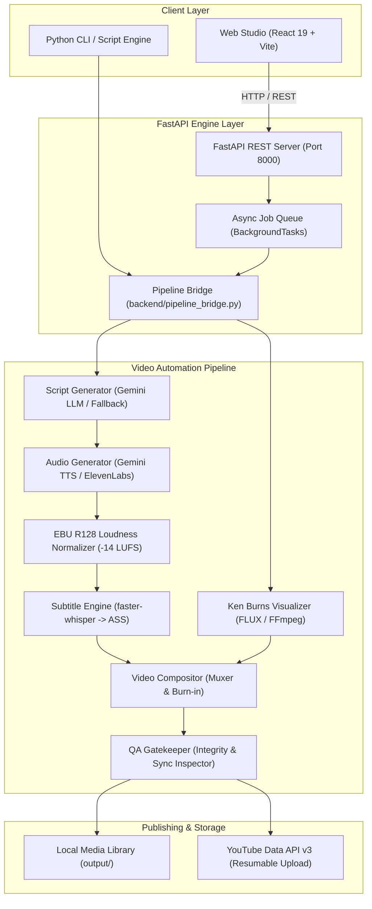

<div align="center">

# ⚡ FacelessReels

**An Open-Source AI Video Automation Framework for Vertical Reels, Shorts & Video Essays**

[](https://github.com/peacefulcoder-911/faceless-reels/actions/workflows/ci.yml)
[](https://www.python.org/)
[](https://fastapi.tiangolo.com)
[](https://react.dev/)
[](https://github.com/astral-sh/ruff)
[](LICENSE)

*Script, voice, illustrate, animate, caption, render, and publish high-retention 9:16 videos autonomously.*

</div>

---

## 1. Project Introduction

**FacelessReels** is a modular, developer-centric open-source framework designed to automate the entire lifecycle of faceless video creation. From topic research and psychological hook generation to studio-grade voice synthesis, dynamic Ken Burns camera motion, word-by-word karaoke subtitles, and automated YouTube publishing, FacelessReels provides an end-to-end pipeline accessible both programmatically via Python APIs and interactively through a modern web studio.

---

## 2. Problem Being Solved

Creating high-retention short-form video content typically requires juggling 5+ disparate tools:
- LLM prompt engineering for viral scripting
- Paid text-to-speech services with manual pacing adjustments
- Video editors (Premiere, CapCut, DaVinci) to slice clips and sync audio
- Caption generators with manual word-timing corrections
- Manual exporting, metadata writing, thumbnail creation, and platform uploading

**FacelessReels solves this fragmentation** by uniting scripting, audio mastering, visual synthesis, caption typesetting, and publishing into a single deterministic, testable, open-source pipeline.

---

## 3. Key Features

- **8 Curated Content Niches:** Tested retention formulas and visual aesthetic styles across Biblical Stories, Anime Lore, Heists & True Crime, Mythology & Legends, School Gossip, Creepypasta/Horror, Historical Enigmas, and Wholesome 3D Animation.
- **Resilient AI Script Engine:** 4-act viral formula (Shock Hook $\rightarrow$ Rapid Setup $\rightarrow$ Suspense Escalation $\rightarrow$ Climax CTA) with structured schema validation and offline template fallbacks.
- **Studio Audio Mastering:** Multi-provider voice synthesis (Gemini TTS Achird voice, ElevenLabs multi-voice, or local system TTS) mastered with broadcast EBU R128 loudness normalization (`-14 LUFS`, `-1.5 dB TP`).
- **Acoustic Subtitle Engine:** Millisecond-accurate word-level forced alignment (via `faster-whisper`), instant pause clearing, and high-visibility ASS styled karaoke animations (MrBeast Gold, Neon Emerald, Cyberpunk Cyan, Fire Ruby).
- **Dynamic Ken Burns Visualizer:** Multi-preset cinematic camera motion (slow zoom-in, dramatic pull-back, downward tilt, and climax push-in) rendered directly onto 9:16 vertical canvas.
- **Deterministic QA Gatekeeper:** Pre-upload inspection verifying video/audio stream integrity, audio-visual synchronization ($\le 0.35\text{s}$ desync tolerance), narrative completion, and resolution bounds.
- **YouTube Publishing & Metadata Automation:** Algorithmic CTR title generation, entity tags, 00:00 chapter timestamps, resumable chunked video uploads, and pinned discussion comments.
- **Modern Web Studio:** React 19 + Vite dashboard with interactive wizard, live 9:16 video player preview, and autonomous scheduler monitoring.

---

## 4. Architecture Overview



---

## 5. System Requirements

- **Operating System:** macOS (Apple Silicon or Intel), Linux (Ubuntu 20.04+), Windows 10/11 (WSL2 recommended)
- **Python:** `3.10`, `3.11`, `3.12`, or `3.13`
- **Node.js:** `18.0.0+` & npm (for web frontend)
- **FFmpeg & ffprobe:** Required on system `PATH`
  - macOS: `brew install ffmpeg`
  - Ubuntu/Debian: `sudo apt-get install -y ffmpeg`
  - Windows: `winget install Gyan.FFmpeg`

---

## 6. Installation Instructions

### 1. Clone the Repository
```bash
git clone https://github.com/peacefulcoder-911/faceless-reels.git
cd faceless-reels
```

### 2. Set Up Python Environment
```bash
python3 -m venv .venv
source .venv/bin/activate  # On Windows: .venv\Scripts\activate
pip install --upgrade pip
pip install -r requirements.txt
```

### 3. Install Development & Testing Dependencies (Optional)
```bash
pip install -r requirements-dev.txt
```

### 4. Install Frontend Dependencies
```bash
cd frontend
npm install
cd ..
```

---

## 7. Configuration Instructions

Copy `.env.example` to `.env`:
```bash
cp .env.example .env
```

Open `.env` and set your credentials:

```dotenv
# Google Gemini API Key (Required for AI Scripting & TTS)
GEMINI_API_KEY=your_gemini_api_key_here

# ElevenLabs API Key (Optional: for premium multi-voice synthesis)
ELEVENLABS_API_KEY=your_elevenlabs_api_key_here

# YouTube OAuth Client Secrets (Optional: for autonomous uploading)
YOUTUBE_CLIENT_SECRETS_FILE=config/client_secrets.json
YOUTUBE_TOKEN_FILE=config/youtube_token.json

# Server Config
PORT=8000
HOST=127.0.0.1
```

> [!NOTE]
> FacelessReels includes an **offline resilient mode**. If no API keys are provided, the pipeline automatically uses built-in narrative templates and system text-to-speech for testing and local development.

---

## 8. Quick-Start Guide

### Launch Backend Server
```bash
source .venv/bin/activate
uvicorn backend.main:app --host 127.0.0.1 --port 8000 --reload
```

### Launch Web Studio (in another terminal)
```bash
cd frontend
npm run dev
```

Open your browser to: **[http://localhost:5173](http://localhost:5173)**

---

## 9. Usage Examples

### Programmatic Python Usage

```python
from backend.pipeline_bridge import (
    generate_script_engine,
    synthesize_audio_engine,
    generate_subtitles_engine,
    assemble_reel_engine,
)

# 1. Generate Structured 4-Scene Script
script = generate_script_engine(
    niche="history",
    topic="The Lost Amber Room",
    duration=45
)
print(f"Hook: {script['hook']}")

# 2. Synthesize & Master Voiceover Audio
audio_path = "output/audio/amber_room.wav"
synthesize_audio_engine(
    script_text=script["fullScript"],
    voice_name="deep_narrator",
    output_wav_path=audio_path
)

# 3. Compile Word-by-Word ASS Karaoke Captions
ass_path = "output/temp/amber_room.ass"
generate_subtitles_engine(
    audio_path=audio_path,
    script_text=script["fullScript"],
    caption_style_id="mrbeast",
    output_ass_path=ass_path
)

# 4. Assemble Vertical 1080x1920 Reel
final_mp4 = "output/final_video/amber_room.mp4"
assemble_reel_engine(
    audio_path=audio_path,
    subtitles_path=ass_path,
    output_mp4_path=final_mp4,
    scenes=script["scenes"],
    niche="history"
)
print(f"✅ Video ready: {final_mp4}")
```

### Running the Automation Pipeline via CLI

```bash
python automation/run_pipeline.py --category "History"
```

---

## 10. API Integrations

| Provider | Purpose | Fallback Strategy |
| :--- | :--- | :--- |
| **Google Gemini (`google-genai`)** | Script synthesis, hook creation, topic planning | Deterministic viral story beat templates |
| **Google Gemini TTS / ElevenLabs** | Broadcast voiceover narration | Local system TTS (`say` / synthesized tone) |
| **faster-whisper** | Acoustic millisecond speech-to-text alignment | Linear speech rate token pacing |
| **FLUX / Pollinations AI** | Scene-matched vertical background art | High-contrast gradient motion canvases |
| **YouTube Data API v3** | Resumable video upload, chapters, comments | Local filesystem archiving with verification |

---

## 11. Testing & Code Quality

FacelessReels enforces strict test coverage and static analysis.

### Run Unit & Integration Tests
```bash
pytest tests/ backend/
```
*(All 27 test cases execute with zero paid/network calls using local mocks).*

### Run Linting
```bash
ruff check .
```

---

## 12. Troubleshooting

<details>
<summary><strong>1. FFmpeg not found or command failed</strong></summary>

Make sure FFmpeg is installed and accessible in your shell:
```bash
ffmpeg -version
ffprobe -version
```
If not found, install via Homebrew (`brew install ffmpeg`) or APT (`sudo apt-get install -y ffmpeg`).
</details>

<details>
<summary><strong>2. faster-whisper model download or memory issues</strong></summary>

`faster-whisper` uses the lightweight `tiny` or `base` model by default. If running in low-memory environments, the pipeline gracefully falls back to duration-based speech interpolation.
</details>

<details>
<summary><strong>3. Gemini API 403 or Rate Limit</strong></summary>

Ensure your `GEMINI_API_KEY` is valid and has active quotas in Google AI Studio. If the key is invalid or unset, FacelessReels triggers the resilient story beat fallback automatically.
</details>

---

## 13. Contributing

We welcome community contributions! Please read our [Contributing Guide](CONTRIBUTING.md) and [Code of Conduct](CODE_OF_CONDUCT.md) before submitting pull requests.

Check open issues with the [`good first issue`](https://github.com/peacefulcoder-911/faceless-reels/labels/good%20first%20issue) label to get started.

---

## 14. License

This project is licensed under the terms of the **MIT License**. See [LICENSE](LICENSE) for details.
*(License selection is pending final maintainer publication approval).*
